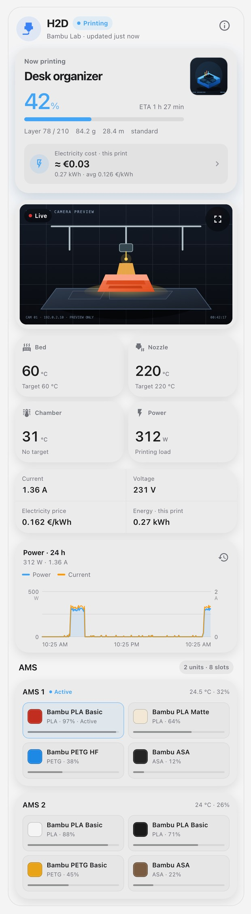
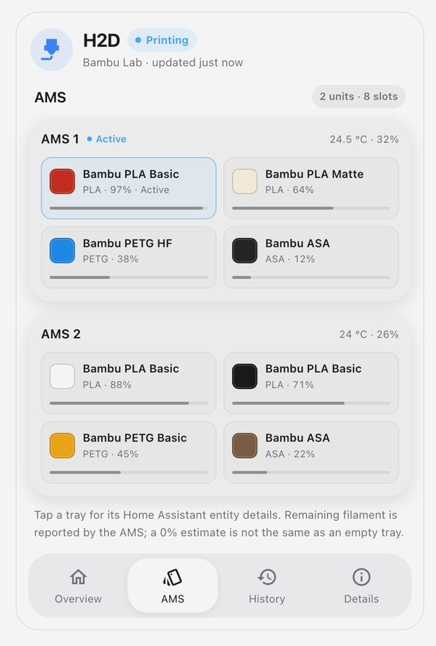
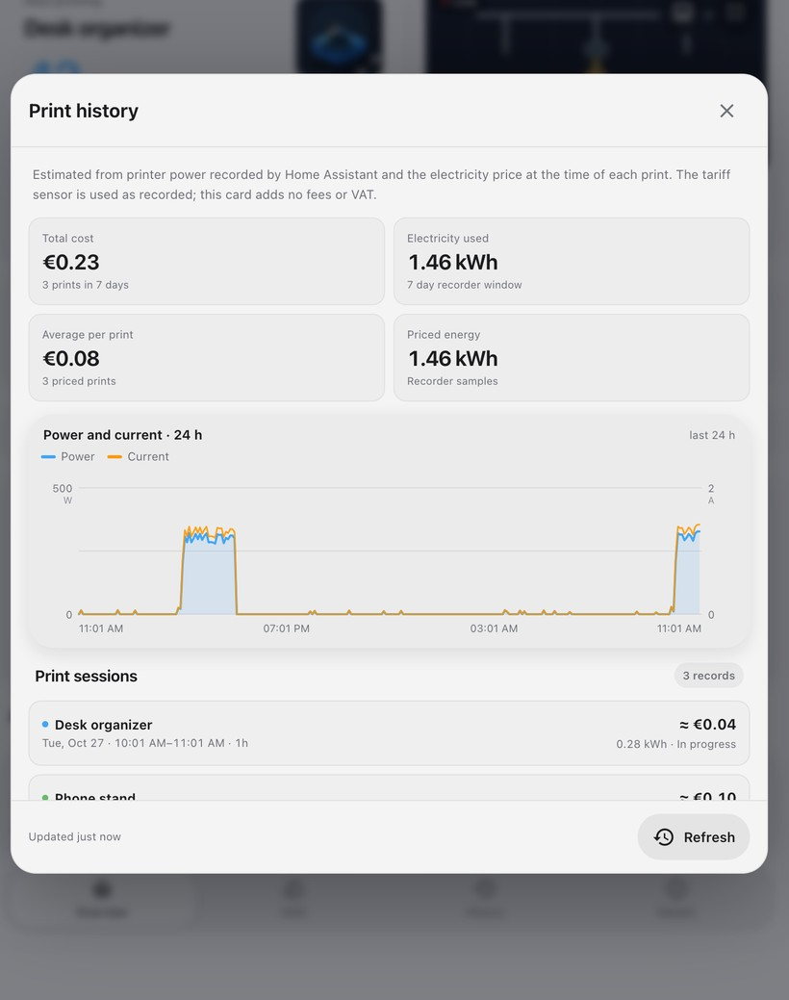
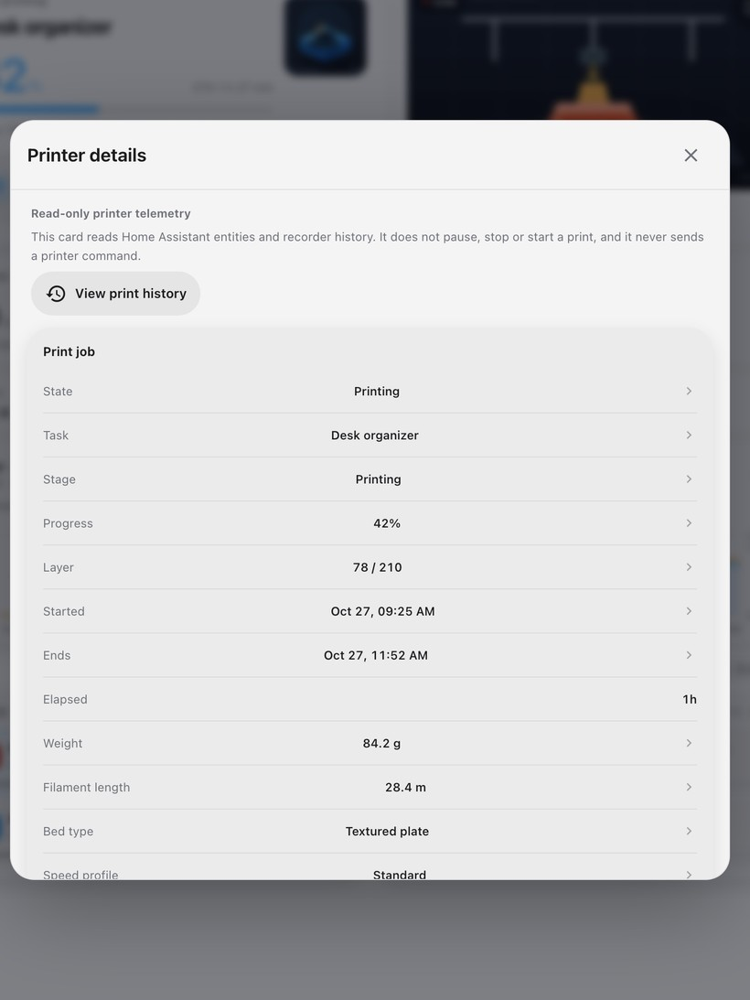

# Bambu Lab Printer Card

A Home Assistant Lovelace card for Bambu Lab printers: live camera, AMS state,
temperatures, power and **electricity cost per print**, in the
[Space Hub](https://github.com/bitosome/space-hub-card) design language.

Built with the pinned `@bitosome/ha-card-ui` design library. One JavaScript
module, no ApexCharts, no backend integration, no runtime sibling imports.



<sub>Synthetic preview: synthetic readings and a synthetic camera frame. No
printer was contacted.</sub>

## What you get

- **Printing now / last print** — task name, progress, ETA, layers, filament
  weight and length, speed profile and the current print's cover image. Tap the
  cover image for a full print preview.
- **Live camera** — the same Home Assistant camera/WebRTC elements used by the
  custom camera card, with native fullscreen and an expandable shared-dialog fallback, a loading state, a still-image
  fallback and a live/snapshot toggle.
- **Print cost** — current or last print electricity estimate, energy used and
  weighted average tariff. Tap it for the full print history.
- **Print history** — per-print cost and energy, total and average cost for the
  selected Recorder window, and a 24-hour power/current chart with the same
  data the old ApexCharts card showed. Each record expands to show its start,
  end, average tariff, unpriced energy and partial-estimate reasons.
- **AMS** — a compact AMS summary on the overview (active tray, remaining
  filament, colours, loaded count) and a dedicated AMS page with every unit and
  tray: colour, material, remaining percentage, active tray, unit
  temperature/humidity and drying state. Loaded external spools appear
  automatically.
- **Telemetry** — bed, nozzle and chamber temperatures with targets; smart-plug
  power, current and voltage; electricity price and print energy. Each tile
  opens its native Home Assistant entity details.
- **Notices** — HMS messages, print errors, offline/unavailable telemetry and an
  open enclosure door while printing.
- **Bottom navigation** — Overview, AMS, History and Details, matching the heat
  pump card's navigation pattern. History and Details open the shared modal
  flow; the print history has per-print records and the 24-hour chart.
- **Details** — a read-only dialog with print job, temperatures, fans, power and
  cost, machine, AMS and HMS data. Rows open Home Assistant's native more-info.
- **Responsive and theme-aware** — one column on phones, two AMS cards side by
  side and four metrics across on wider cards; light and dark themes; 44px
  touch targets, keyboard focus and reduced-motion support.

The card is deliberately **read-only**. It does not pause, stop or start a
print, and it never sends a printer command. Use Bambu Handy, Bambu Studio or
the Bambu Lab integration for control.

## Install

### HACS (custom repository)

This is a **Dashboard** repository, not an entry in the default HACS catalog.

1. In HACS, open **Custom repositories**.
2. Add `https://github.com/bitosome/3d-printer-card`, category **Dashboard**.
3. Download **Bambu Lab Printer Card** and reload the frontend.
4. Verify the resource
   `/hacsfiles/3d-printer-card/bambu-printer-card.js` is registered as a
   **JavaScript module**.
5. Add the **Bambu Lab Printer Card** from the card picker, then select your
   printer status entity in the visual editor.

### Manual

1. Download `bambu-printer-card.js` from a release, or use
   `dist/bambu-printer-card.js` from the repository.
2. Put it in `/config/www/community/3d-printer-card/bambu-printer-card.js`.
3. Add `/hacsfiles/3d-printer-card/bambu-printer-card.js?v=0.2.3` as a dashboard
   resource of type **JavaScript module**.
4. Reload the frontend and add the card.

## Prerequisites

- Home Assistant with the
  [Bambu Lab integration](https://github.com/greghesp/ha-bambulab) (the
  `bambu_lab` integration).
- The printer's **Print status** entity. The card derives the rest of the printer
  entities from its prefix.
- Optional but recommended for cost:
  - a smart-plug or meter **power** sensor in W (`sensor.*_power`), or a
    cumulative **energy** sensor in kWh as a fallback;
  - an electricity **price** sensor in currency/kWh. The
    [Real Electricity Price](https://github.com/bitosome/real-electricity-price)
    integration is a natural fit, but any price sensor with a unit such as
    `€/kWh` works.

History is read from **Home Assistant Recorder**. The default Recorder
retention is 10 days; the card can request up to 30 days, but it can only show
what Recorder still has. Past prints are reconstructed when their status,
power (or energy), and price history are available. The card does not create
a separate permanent ledger.

## Configuration

Minimal:

```yaml
type: custom:bambu-printer-card
printer_entity: sensor.<printer>_print_status
```

Full example:

```yaml
type: custom:bambu-printer-card
printer_entity: sensor.<printer>_print_status
name: H2D
power_entity: sensor.<printer>_power
energy_entity: sensor.<printer>_energy
current_entity: sensor.<printer>_current
voltage_entity: sensor.<printer>_voltage
price_entity: sensor.real_electricity_price_current_price
camera_entity: camera.<printer>_camera
history_days: 7
currency: EUR
show_camera: true
show_ams: true
```

| Option | Required | Description |
| --- | --- | --- |
| `printer_entity` | yes | The Bambu Lab **Print status** sensor, usually `sensor.<prefix>_print_status`. |
| `entity_prefix` | no | The part before `_print_status`, if the status entity does not follow that pattern. |
| `name` | no | Display name. Falls back to `sensor.<prefix>_printer_name`, then "3D printer". |
| `power_entity` | cost | Smart-plug/meter power in W. Preferred cost basis. |
| `energy_entity` | fallback | Cumulative energy in kWh. Used when no power sensor is selected. |
| `current_entity` | no | Current in A, shown in the telemetry strip. |
| `voltage_entity` | no | Voltage in V, shown in the telemetry strip. |
| `price_entity` | cost | Electricity price in currency/kWh. Its recorded history prices each interval. |
| `camera_entity` | no | Camera entity. Defaults to `camera.<prefix>_camera`. |
| `history_days` | no | Recorder window for print history, 1–30; default 7. |
| `currency` | no | ISO 4217 code for cost display. Derived from the price unit when possible. |
| `show_camera` | no | Default `true`. Set `false` to save camera bandwidth. |
| `show_ams` | no | Default `true`. Set `false` to hide the AMS section. |

### Entity discovery

The card reads the following from `sensor.<prefix>_*`, `binary_sensor.<prefix>_*`,
`camera.<prefix>_camera` and `image.<prefix>_cover_image` when they exist:

- print status, task name, progress, stage, remaining time, start/end time,
  current/total layer, print weight/length, bed type, speed profile, print type,
  G-code file, printable objects;
- bed, bed target, chamber, chamber target, nozzle, nozzle target, left/right
  nozzle temperatures, nozzle size, tool module;
- cooling, auxiliary, chamber and heatbreak fan speeds;
- HMS errors, print error, online, enclosure door, extruder filament sensor,
  firmware update, developer LAN mode;
- Wi-Fi signal, IP address, MQTT mode, SD-card status, total usage, chamber and
  heatbed lights;
- AMS units: `sensor.<prefix>_ams_<n>_tray_<n>`, unit temperature/humidity,
  remaining drying time, `binary_sensor.<prefix>_ams_<n>_active` and `_drying`;
- external spools: `sensor.<prefix>_externalspool*_external_spool`;
- the active tray: `sensor.<prefix>_active_tray`.

Entity names come from the Bambu Lab integration. If your integration version
uses a different prefix, set `entity_prefix` explicitly. Missing entities are
omitted instead of replaced with fake readings.

## Electricity cost

Print cost is an **estimate**, not a billing-meter guarantee.

1. A print session starts when the Bambu **Print status** moves to `prepare` or
   `running`, survives `pause` and short integration reconnects, and ends at
   `finish`, `failed` or `idle`. A long offline/unavailable period ends the
   record as partial.
2. Power is integrated over the recorded smart-plug samples (sample-and-hold,
   W → kWh). Each interval uses the electricity price recorded at that time, so
   a price change mid-print is handled without repricing earlier energy.
3. Missing power is **not** filled with stale data. A powered interval longer
   than an hour, an unavailable reading, a cumulative-counter reset or a long
   telemetry gap marks the record partial.
4. Missing prices produce **unpriced energy** rather than a zero-cost print.
   Negative tariffs are valid and can produce a negative estimate.
5. The live estimate is seeded from Recorder when the card loads, then updated
   from Home Assistant state changes. It re-seeds after five minutes, when the
   tab becomes visible, and whenever the card has to recover from a background
   gap. When a print ends, the completed record is recomputed from Recorder
   and an open History dialog refreshes automatically. Older snapshots cannot
   override a newer completed estimate. If sensors change while Recorder is
   loading, the unrecorded tail remains provisional until the next reconciliation.
6. Cumulative plug energy is the fallback when power history is absent. Each
   observed meter delta is allocated uniformly between its two readings to
   estimate the part inside the print and split tariff changes. It never
   extrapolates past the last reading. Missing boundary readings, counter
   resets, unavailable data or intervals over six hours make the estimate
   partial; sparse meter updates cannot reveal the exact timing of consumption.

The tariff sensor is used as recorded. If that sensor already includes fees and
VAT, the card adds nothing; if it does not, neither does the card. Electricity
cost does not include filament, depreciation or failed-print material.

The history list is built from the same Recorder data. A session that started
before the Recorder window is marked partial. The chart always shows the last
24 hours; the summary and session list use the configured `history_days` window.

## Design and interaction

The card composes the shared `@bitosome/ha-card-ui` tokens, family surfaces,
metric grid, notices, glow helpers and native dialog flow. It follows the same
rules as the other bitosome cards:

- main readings stay on the card; metric and telemetry tiles open Home
  Assistant's native entity more-info, while substantial history and details
  open from the common bottom navigation modal flow;
- a telemetry update never resets focus, scroll or an expanded history record;
- the activation glow sits under the common tile group, not on each tile;
- controls are buttons with visible focus and at least a 44px tap target;
- the AMS summary opens the dedicated AMS page, and the model preview opens a
  full image dialog;
- the card is contained by `overflow: clip`, so its glow cannot paint over
  neighbouring dashboard cards.



The bottom navigation mirrors the heat pump card: **Overview** and **AMS** are
inline pages, while **History** and **Details** open the shared modal flow.



The details dialog keeps the main card quiet and puts fans, machine data, AMS
summaries and HMS messages behind a read-only disclosure.



## Privacy and safety

- The card calls only `GET history/period/...` through Home Assistant. It does
  not call services, create helpers, use a browser ledger or contact any cloud
  service.
- The camera and image URLs are Home Assistant's authenticated proxy URLs.
- Nothing is sent to the printer. The card cannot pause, stop, start or change
  a print.
- The repository's preview uses fictional readings, a fictional serial number,
  a documentation IP address and a synthetic camera frame.

## Limitations

- Built against the entity naming and attributes of the Bambu Lab integration.
  Different integration versions or AMS variants may omit some entities; the
  card hides what it cannot find.
- The live camera depends on the integration's stream support and Home
  Assistant's stream/WebRTC stack. A still image is shown when a stream is not
  available.
- Cost accuracy follows Recorder sampling and the smart plug's measurement. The
  card skips long gaps instead of guessing.
- The cost boundary is the Bambu print status: cooldown or standby after
  `finish` is not part of that print's record.
- `history_days` is limited by Recorder retention; the card cannot recover data
  that Recorder has purged.

## Development

```sh
npm ci
npm run check          # typecheck, build, model tests, smoke tests
python3 -m http.server 8788
# open http://127.0.0.1:8788/preview/
```

The preview uses synthetic Home Assistant state and synthetic history; it does
not contact a printer. `npm run build` emits the single
`dist/bambu-printer-card.js` bundle committed for HACS releases.

The shared library is pinned to
`@bitosome/ha-card-ui@1.0.1` and bundled into the card. The card has no runtime
dependency on a sibling repository.

## License

MIT © Artjom Kuznetsov. See [LICENSE](LICENSE).
